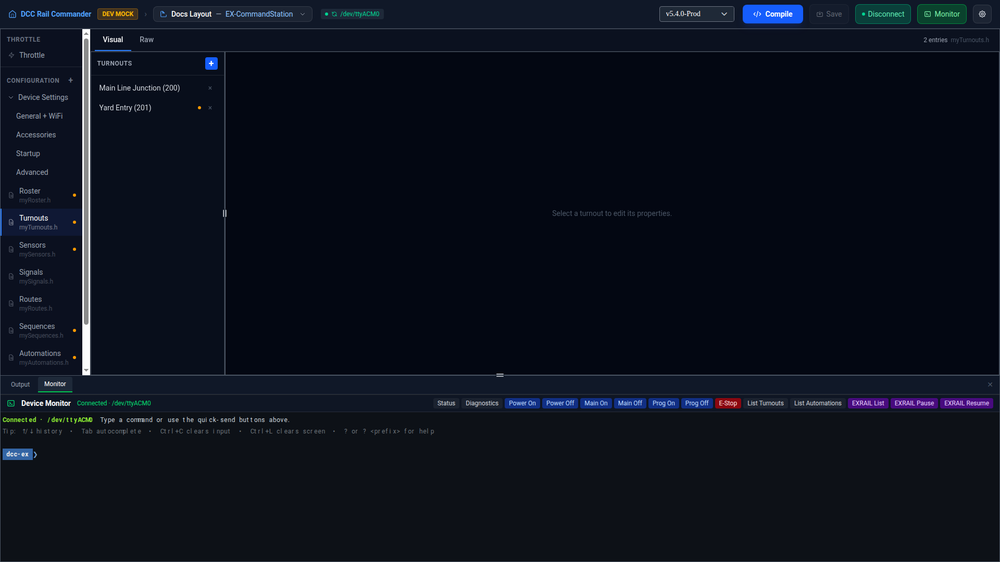
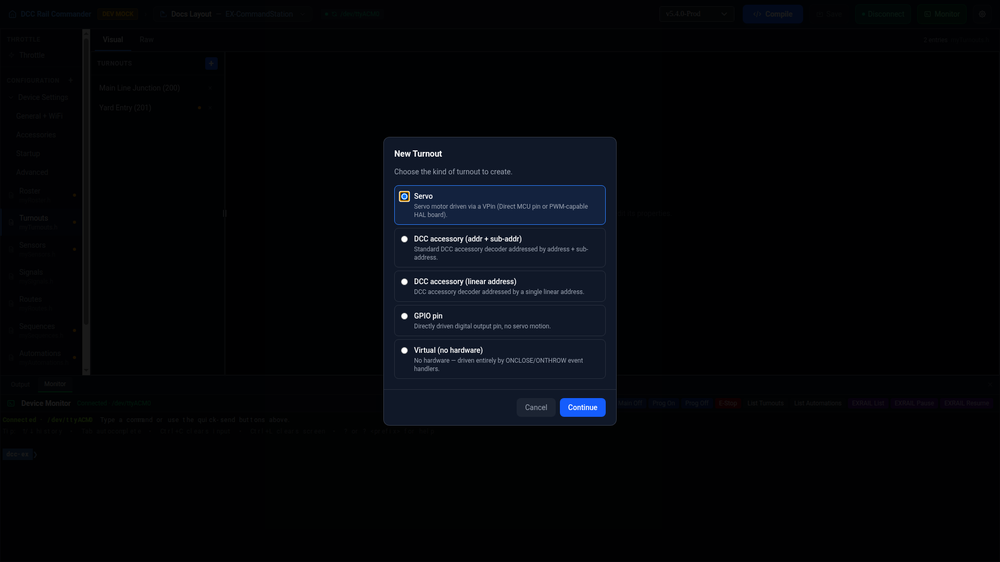
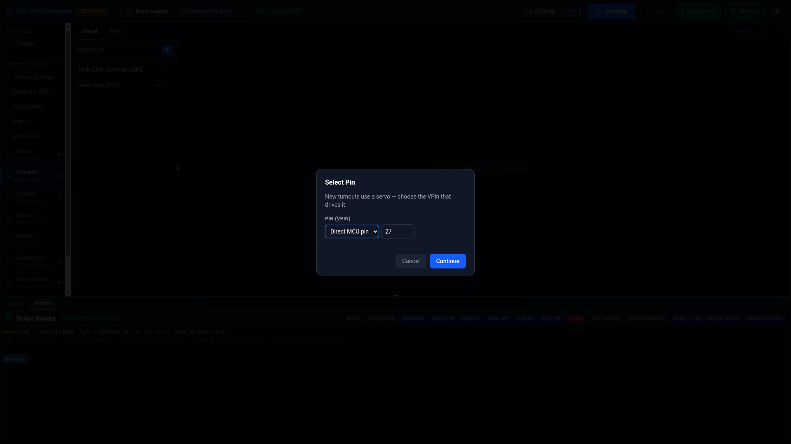
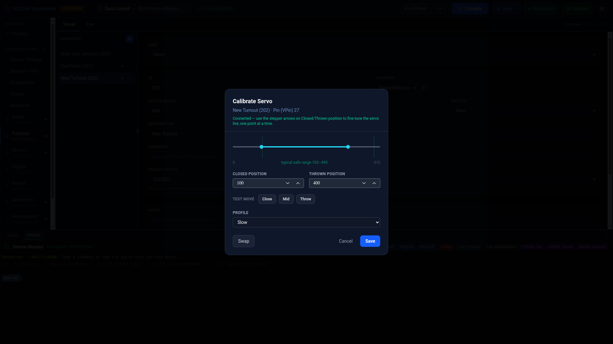

# Turnouts

The Turnouts editor manages `myTurnouts.h` — every turnout your layout controls, whatever drives it: a servo,
a DCC accessory decoder, a GPIO pin, or no hardware at all.



## Layout

The left sidebar shows your turnouts as a tree. Each turnout is listed by description (or `Turnout <id>` if it
has none); an amber dot marks any entry with no alias set while **Strict aliases** is enabled (see
[Aliases](#aliases) below). Click a row to load it into the detail panel. Each row has a **⋯** button (also
available by right-clicking) with the actions for that row: **Add Turnout Here…**, **New Folder…**,
**Rename Folder…**, **Delete Folder**, **Clone…** and **Delete** (with a confirmation prompt) — only the ones
that apply to the row you opened it on are shown. Click **+** in the sidebar header to add a new turnout, or the
folder button next to it to add a folder.

With a small layout the tree is just a flat list. Once you have a lot of turnouts, see
[Organizing turnouts](#organizing-turnouts) below to group them.

## Adding a turnout

Click **+**. A **New Turnout** dialog opens first, asking which kind to create:



| Kind | Description |
|---|---|
| **Servo** *(preselected)* | Servo motor driven via a VPin (a direct MCU pin, or a channel on a PWM-capable HAL board). |
| **DCC accessory (addr + sub-addr)** | Standard DCC accessory decoder, addressed by address + sub-address. |
| **DCC accessory (linear address)** | DCC accessory decoder addressed by a single linear address. |
| **GPIO pin** | Directly driven digital output pin — no servo motion. |
| **Virtual (no hardware)** | No hardware; driven entirely by `ONCLOSE`/`ONTHROW` event handlers elsewhere. Can also act as a group — see [Virtual turnouts as groups](#virtual-turnouts-as-groups). |

Choosing **Servo** opens a second dialog to pick the driving pin before the entry is created:



The new turnout is created with the next unused turnout ID (or `200` if the list is empty). A new **Servo**
turnout jumps straight into the servo calibration dialog (below) so you can set a sensible position before
doing anything else.

## Organizing turnouts

As the number of turnouts grows, you can arrange them in the sidebar tree. There are two kinds of branch:

| Branch | What it is | Effect on your layout |
|---|---|---|
| **Folder** | A named container, like `Yard` or `Yard / East`. Folders can be nested. | **None.** Purely for organizing the list. |
| **Virtual turnout** | A [Virtual](#adding-a-turnout) turnout with other turnouts placed under it. | **Wires them to the virtual turnout's events** — see [below](#virtual-turnouts-as-groups). |

Turnouts are always the leaves of the tree.

!!! important "Folders are for organization only"
    Putting a turnout in a folder, moving it between folders, or renaming or deleting a folder **never changes
    what is compiled or uploaded to your CommandStation**. The turnout keeps the same ID, the same hardware
    settings and the same `SERVO_TURNOUT(...)` / `TURNOUT(...)` / `PIN_TURNOUT(...)` line in `myTurnouts.h`.
    Folders exist only to help *you* find things in the editor.

    The only case where a turnout's position in the tree changes the firmware is when it sits **under a Virtual
    turnout**.

### Working with folders

- **Create a folder** with the folder button in the sidebar header, or **New Folder…** from a row's **⋯** menu
  (on a folder row this creates a subfolder). Folder names can't contain `/`, or be blank. An empty folder is
  kept, so you can set up your structure before adding turnouts.
- **Rename** a folder from its **⋯** menu or from the panel shown when you select it. Renaming carries
  everything inside it along.
- **Delete** a folder the same way. **Its turnouts are not deleted** — they move up one level, into the
  folder's parent (or the top level).
- **Add a turnout into a folder** by selecting the folder and clicking **+**, or from **Add Turnout Here…** on
  its row. With a turnout selected, **+** adds the new turnout next to it.

### Moving turnouts

There are two ways, both equivalent:

- **Drag and drop** a turnout (or a whole folder) onto a folder or a Virtual turnout to move it in. Drop it on
  an ordinary turnout to put it at that turnout's level, or on empty space to move it to the top level. The
  cursor shows a **+** only where the item can really be nested — a folder or a Virtual turnout — and a
  no-entry symbol where a drop isn't allowed (onto itself, or a folder into one of its own subfolders).
- The **Location** drop-down on a turnout's detail panel (in the Kind card) lists **Top level**, every folder,
  and every Virtual turnout it can go under.

### Virtual turnouts as groups

A Virtual turnout can also be a branch: place other turnouts under it and they become its children. Use this
when one throw/close of a virtual turnout should drive several real turnouts — for example a single "Yard Hub"
control that sets a whole ladder of points.

DCC Rail Commander keeps the matching EX-RAIL in `myEvents.h` for you. When a turnout is placed under a Virtual
turnout `Yard Hub` (ID `300`), the editor makes sure these handlers exist and include the child:

```
ONCLOSE(300)
CLOSE(201)
DONE

ONTHROW(300)
THROW(201)
DONE
```

- **Adding** a turnout under the Virtual turnout adds it to both handlers; **creating** either handler first if
  it doesn't exist yet.
- **Moving it out**, or deleting it, removes its lines again. If you change the turnout's ID, its lines follow.
- **Aliases are used when set.** A turnout with an alias is written by name — `ONCLOSE(YARD_HUB)`,
  `CLOSE(YARD_ENTRY)` — otherwise by number. If you add, rename or clear an alias later, the generated lines are
  updated to match, so they keep working with [Strict aliases](#aliases) and show correctly in the
  [Event Handlers](event-handlers.md) block editor.
- **Your own handlers are respected.** An existing `ONCLOSE(300)` you wrote by hand is recognised (by number or
  by alias) and the child is added to it rather than creating a second one. A handler that shares its body with
  another trigger (for example `ONCLOSE(300)` stacked with `ONCLOSE(301)`) is left alone, and the child gets its
  own handlers instead.
- If you **delete the Virtual turnout** or change it to another kind, its children are moved up one level (to
  the Virtual turnout's own folder, or the top level), and the existing handlers are left exactly as they were —
  nothing you wrote is removed.
- If you **change the Virtual turnout's ID**, its children stay attached and get fresh handlers under the new ID.
  The old `ONCLOSE`/`ONTHROW` handlers for the previous ID are left as they were, so remove them yourself if
  they're no longer wanted.

The Virtual turnout's form shows whether its children are covered:

- *"Turnouts placed under this one in the tree are added to its ONCLOSE/ONTHROW events automatically."* — no
  children yet.
- *"Events set up: N turnouts in ONCLOSE/ONTHROW (myEvents.h)."* — everything is wired up.
- An amber warning with an **Add missing** button — some children aren't in the events yet. This happens when
  a hierarchy comes from a hand-edited or imported `myTurnouts.h`, since opening a file never changes it.
  Click **Add missing** to generate them.

!!! note
    A turnout is either in a folder **or** under a Virtual turnout, not both. A Virtual turnout can itself live
    in a folder, and can be nested under another Virtual turnout (but never under itself or one of its own
    children).

### How the tree is saved

The tree is stored **only in comments** in `myTurnouts.h`, directly above the entries they apply to, so the
EX-RAIL lines the firmware reads are never altered:

```
// @tree-folder: Spare
// @tree: Yard/East
SERVO_TURNOUT(200, 25, 410, 205, Slow, "Main Line Junction")
VIRTUAL_TURNOUT(300, "Yard Hub")
// @tree: #300
SERVO_TURNOUT(201, 26, 410, 205, Fast, "Yard Entry")
```

| Comment | Meaning |
|---|---|
| `// @tree: Yard/East` | The next turnout lives in folder `Yard`, subfolder `East`. |
| `// @tree: #300` | The next turnout is a child of Virtual turnout `300`. |
| `// @tree-folder: Spare` | An empty folder that has no turnouts yet. |

A tag applies to the **next turnout line only**. You can safely hand-edit these comments in the Raw view; a tag
that points at a missing or non-Virtual turnout, or that would form a loop, is ignored and the turnout simply
shows at the top level, so a turnout is never hidden by a bad tag. Files written before this feature, or by
other tools, have no tags and show as a flat list.

!!! note "Where the tree isn't used yet"
    The throttle's turnouts list doesn't use the folder structure yet — it shows turnouts as a flat list.

## Turnout fields

Every kind shares **ID** (must be unique — saving with a duplicate ID shows an error naming the conflicting
turnout), **Description**, **Comment**, and **Default State**; the rest depend on kind:

| Kind | Kind-specific fields |
|---|---|
| **Servo** | Pin (VPin), Active Angle, Inactive Angle, Profile (`Instant`, `Fast`, `Medium`, `Slow`, `Bounce`). |
| **DCC accessory (addr + sub-addr)** | Address, Sub-Address. |
| **DCC accessory (linear address)** | Linear Address. |
| **GPIO pin** | Pin (VPin). |
| **Virtual** | None — just ID/Description/Comment/Default State. |

Every kind also has a **Location** field (where the turnout sits in the tree — see
[Organizing turnouts](#organizing-turnouts)). It doesn't affect the firmware.

Changing **Kind** on an existing turnout converts it to the new kind's shape, generating fresh defaults for any
newly-required fields while preserving ID, Description, Comment, and Default State. Switching to Servo this way
also opens the pin-picker dialog to choose the driving pin.

## Default State and Startup

**Default State** is `CLOSED` or `THROWN`. Setting it to `THROWN` causes DCC Rail Commander to emit a
`THROW(...)` call in an `AUTOSTART` block in `myStartup.h`, using the turnout's alias name if it has one,
otherwise its numeric ID. See [Startup](startup.md) for how that file's generated blocks work.

## Servo calibration

For a Servo turnout, the detail panel shows a **Configuration Summary** with the current pin, angles, and
profile, plus an angle bar visualizing where the inactive (red) and active (green) positions fall between 0
and 512. Click **Test/Calibrate Servo…** to open the live calibration dialog:



- A range slider (with a shaded typical-safe-range guide around 102–490) sets the **Closed position** and
  **Thrown position** together; dragging it only changes the candidate values, it never moves the servo.
- The **Closed position** / **Thrown position** numeric fields can be typed directly, or fine-tuned one step at
  a time with their spin-button/arrow-key stepper — a stepper move sends a live one-off command to the servo,
  so you can dial it in incrementally.
- **Close** / **Mid** / **Throw** send a one-off test move to the currently-set position, using the selected
  **Profile**.
- **Swap** exchanges the Closed and Thrown values without moving the servo.
- **Profile** here is the same list as on the detail panel and is applied on Save.

Live test moves need the device connected over serial; the dialog shows its connection status (connecting,
connected, unavailable, or error) at the top, and the last command actually sent, so you can tell whether a
move was sent at all versus sent but ignored by the firmware. **Save** validates both positions before writing
them back to the turnout; **Cancel** discards the dialog's changes.

## Aliases

Any turnout can have an alias — a name other config files and EX-RAIL scripts can use instead of the raw
turnout ID. Aliases must start with a letter or underscore and contain only letters, numbers, and underscores;
they can't collide with an EXRAIL command name.

!!! note "Strict aliases"
    An app preference: when enabled, any turnout without an alias is flagged (an amber dot in the sidebar, and
    an error if you try to save it without one).

## Raw view

Switch to the **Raw** tab to edit `myTurnouts.h` directly in a Monaco editor. Lines that can't be parsed back
into the visual model are automatically commented out with `// [INVALID]` and a toast notification appears so
you can find and fix them — they aren't discarded.

The tree is stored in this file too, as `// @tree:` comments (see
[How the tree is saved](#how-the-tree-is-saved)). Editing the raw text replaces the whole tree with whatever
the text says, and does **not** update `myEvents.h` — if you move turnouts under a Virtual turnout this way, use
the **Add missing** button on the Virtual turnout afterwards.
